# Original 3-Day/Week Rehabilitation Program

**Status:** Reproduction of the submitted program, with the placeholder pictures replaced by local exercise illustrations. **This is the original plan, not the recommended revision.**

**Case:** 33-year-old adult.  
**Working diagnosis/needs as stated in the original plan:** chondromalacia patellae, medial knee pain, hamstring/iliopsoas tightness, quadriceps weakness, gluteus maximus inhibition, ankle instability, and trunk stability.

> **Safety:** This training plan is not a medical prescription. Because posterior-medial knee pain and hypermobility have also been reported, review any painful exercise or end-range loading with your physiotherapist. Stop if there is sharp pain, true catching/locking or giving way, or new swelling. A conservative starting guideline is pain no higher than 3/10 during exercise and no increase the next morning.
>
> **Images:** Locally supplied, AI-generated demonstration images. They are **illustrative only** and may simplify equipment or body positions; follow your therapist's instructions rather than copying an image literally.

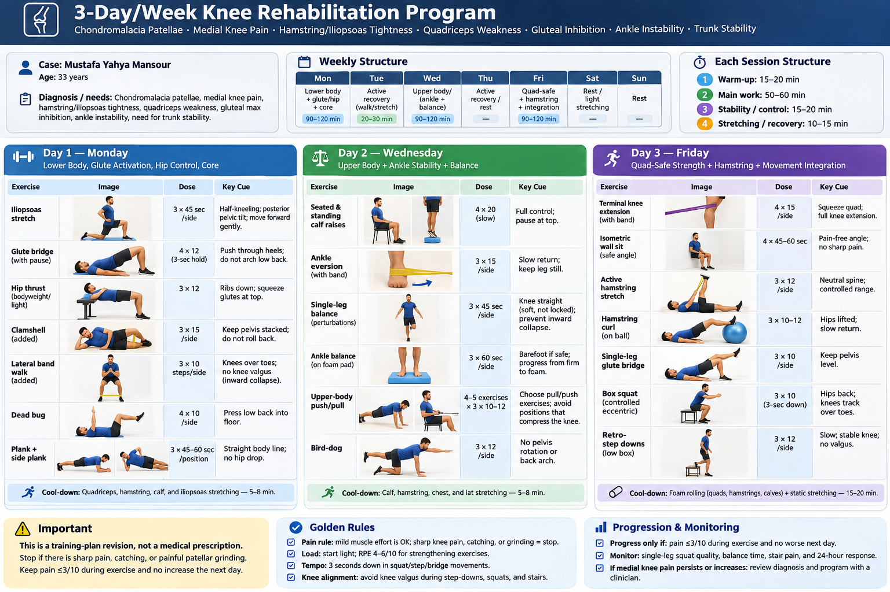

## Weekly structure

| Day | Session | Original duration |
| --- | --- | --- |
| Monday | Lower body + glute/hip control + core | 90–120 min |
| Tuesday | Active recovery: walking/stretching | 20–30 min |
| Wednesday | Upper body + ankle stability + balance | 90–120 min |
| Thursday | Active recovery/rest | — |
| Friday | Quad-safe strength + hamstring + integration | 90–120 min |
| Saturday | Rest or light stretching | — |
| Sunday | Rest | — |

**Original session structure:** Warm-up 15–20 min → main work 50–60 min → stability/control 15–20 min → stretching/recovery 10–15 min.

## Day 1 — Monday: Lower body, glute activation, hip control, core

| Exercise | Illustration | Original dose | Key cue |
| --- | --- | --- | --- |
| Iliopsoas stretch | 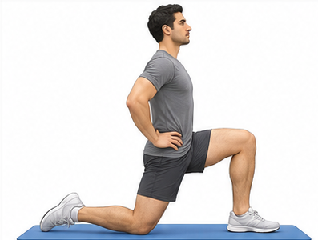 | 3 × 45 sec/side | Half-kneeling; posterior pelvic tilt; shift forward gently. |
| Glute bridge with pause | 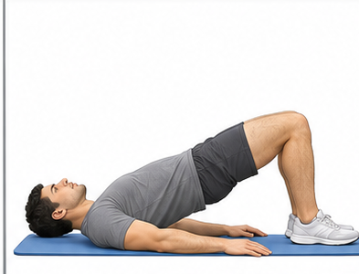 | 4 × 12; 3-sec hold | Push through heels; avoid arching the back. |
| Hip thrust — bodyweight/light | 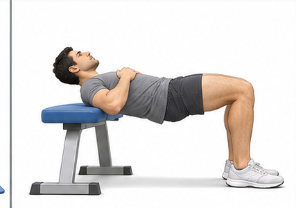 | 3 × 12 | Ribs down; squeeze glutes at top. |
| Clamshell | 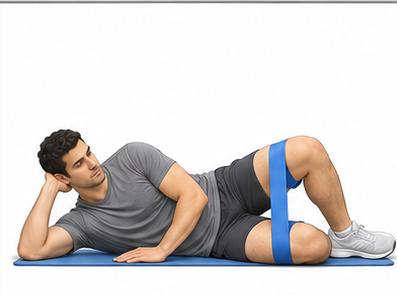 | 3 × 15/side | Keep pelvis stacked; do not roll back. |
| Lateral band walk | 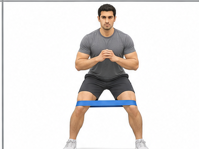 | 3 × 10 steps/side | Control knee tracking. |
| Dead bug | 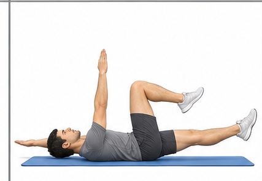 | 4 × 10/side | Maintain trunk control without forcing the low back flat. |
| Plank + side plank | 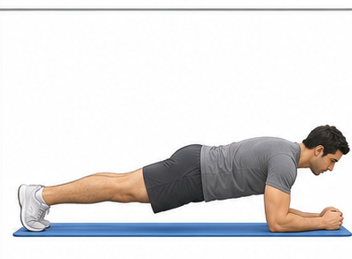 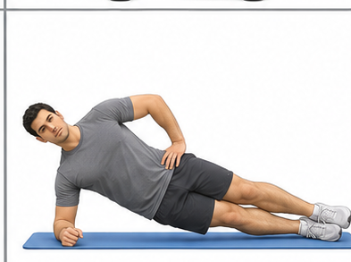 | 3 × 45–60 sec/position | Straight line; no hip drop. |

**Original cool-down:** Quadriceps, hamstring, calf and iliopsoas stretching — 5–8 min.

## Day 2 — Wednesday: Upper body, ankle stability and balance

| Exercise | Illustration | Original dose | Key cue |
| --- | --- | --- | --- |
| Seated & standing calf raises | 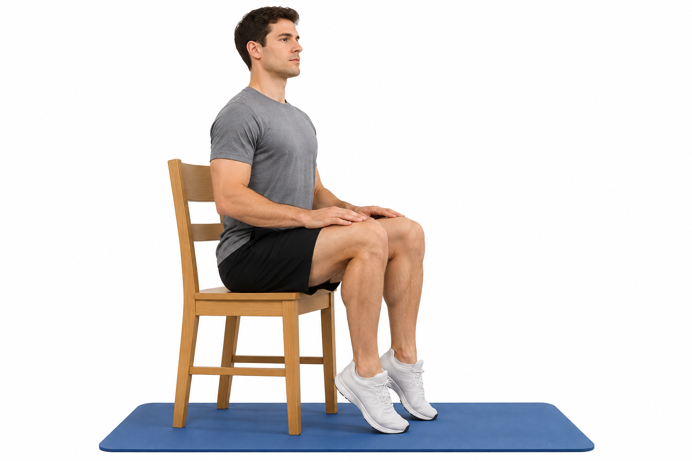 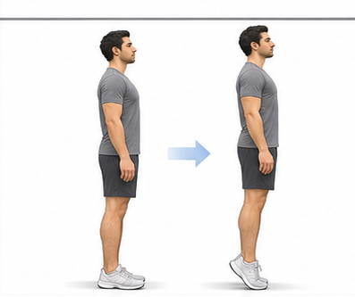 | 4 × 20 slow | Control through available range; pause at top. |
| Ankle eversion with band | 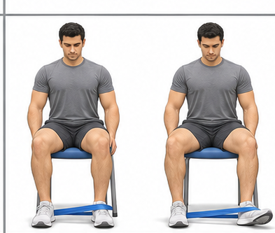 | 3 × 15/side | Slow return; keep leg still. |
| Single-leg balance perturbations | 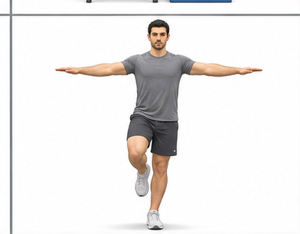 | 3 × 45 sec/side | Avoid locking knee into hyperextension. |
| Ankle balance on foam pad | 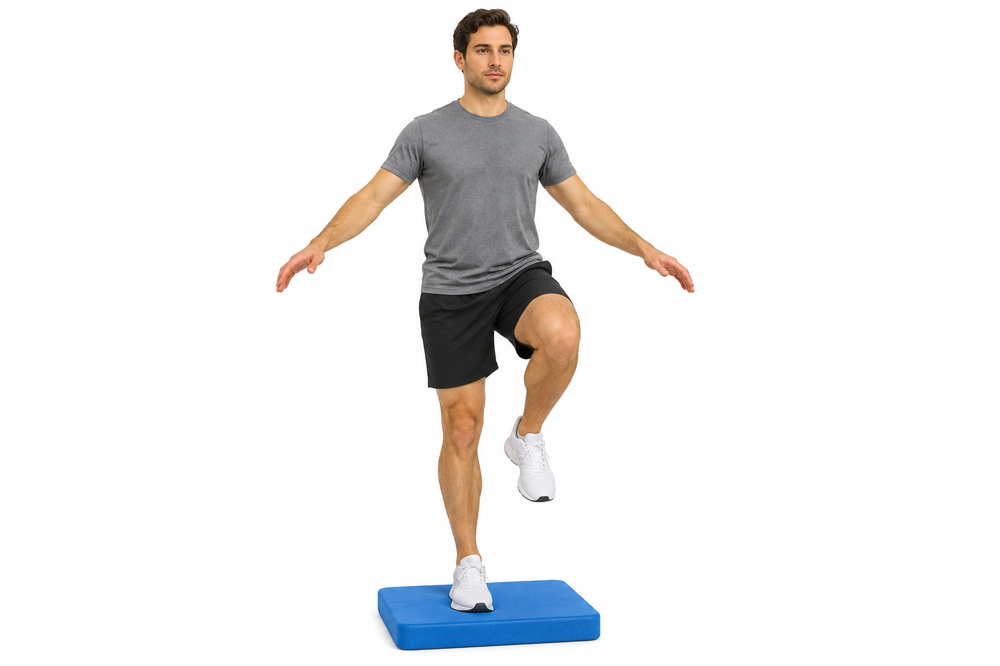 | 3 × 60 sec/side | Progress from firm surface to foam. |
| Upper-body push/pull | 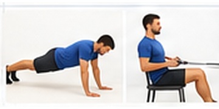 | 4–5 exercises × 3 × 10–12 | Avoid positions that aggravate knee symptoms. |
| Bird-dog | 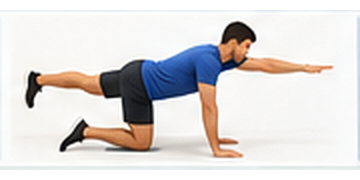 | 3 × 12/side | Avoid rotating the pelvis. |

**Original cool-down:** Calf, hamstring, chest and lat stretching — 5–8 min.

## Day 3 — Friday: Quad-safe strength, hamstrings and movement integration

| Exercise | Illustration | Original dose | Key cue |
| --- | --- | --- | --- |
| Terminal knee extension with band | 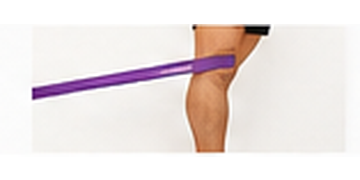 | 4 × 15/side | Squeeze quadriceps; reach controlled extension, not hyperextension. |
| Isometric wall sit | 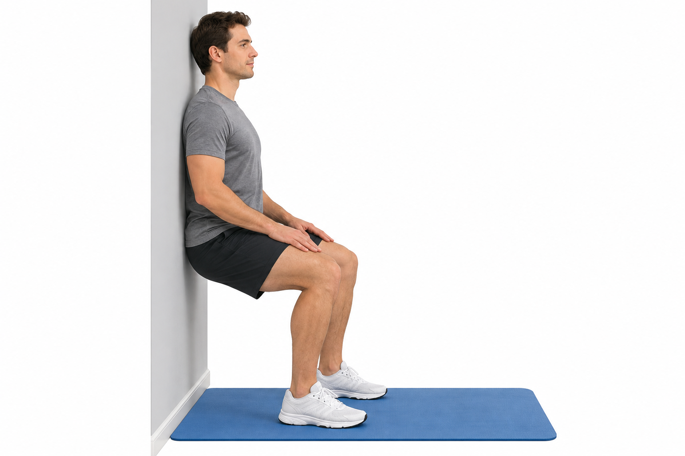 | 4 × 45–60 sec | Choose a tolerable knee angle. |
| Active hamstring stretch | 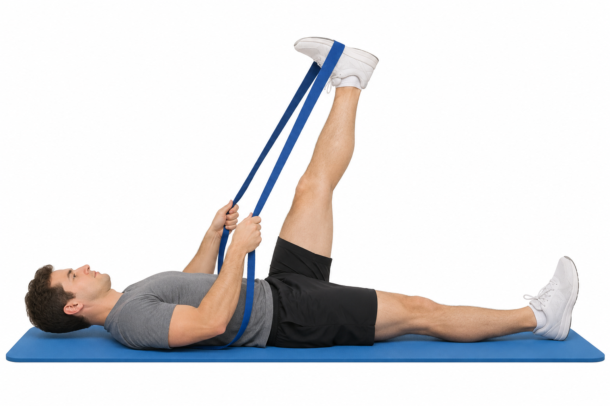 | 3 × 12/side | Neutral spine; controlled range. |
| Hamstring curl on ball | 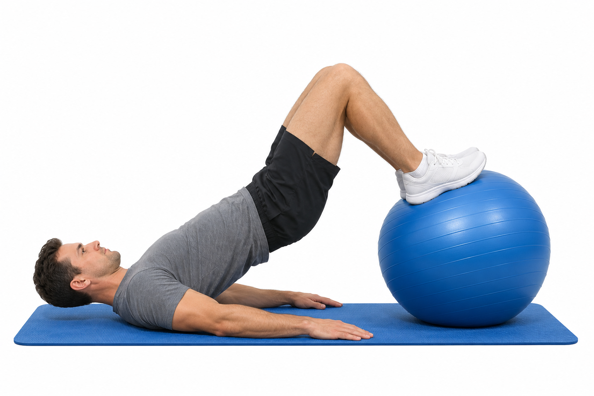 | 3 × 10–12 | Hips lifted; return slowly. |
| Single-leg glute bridge | 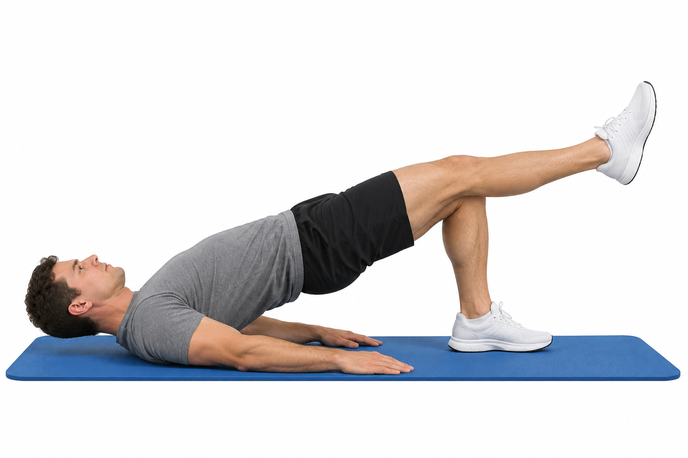 | 3 × 10/side | Keep pelvis level. |
| Box squat — controlled eccentric | 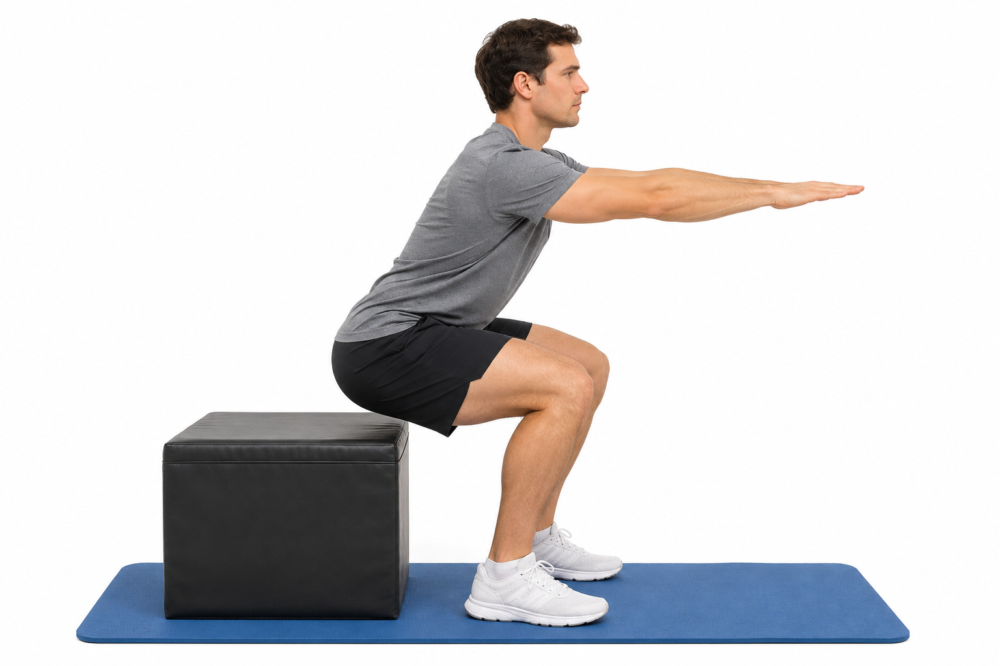 | 3 × 10; 3-sec down | Hips back; knee tracking. |
| Retro-step downs — low box | 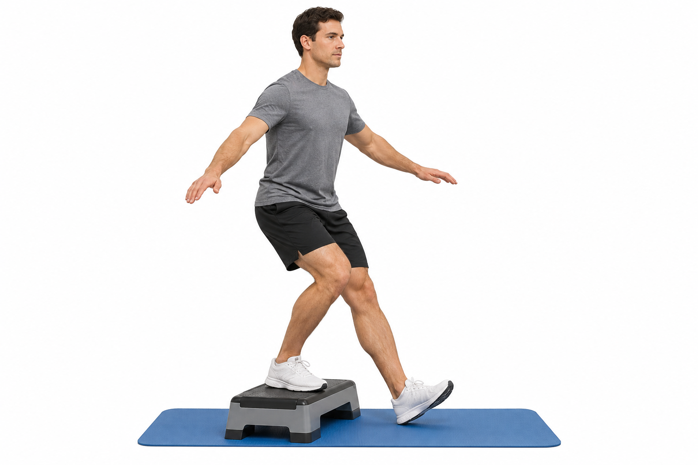 | 3 × 12/side | Controlled lowering; stable knee. |

**Original cool-down:** Foam rolling quads, hamstrings, calves + stretching — 15–20 min.

## Original progression rules

- Begin light at **RPE 4–6/10** and control movement, particularly lowering phases.
- Avoid uncontrolled inward knee collapse; do not force the knee into hyperextension.
- Progress only when pain is **≤3/10** during the session and symptoms are no worse the following day.
- Monitor single-leg squat/step-down quality, balance, stair symptoms, and next-day response.
- Reassess persistent or worsening medial/posterior knee pain with a clinician.

**Review caveat:** The original plan has substantial hip/glute work but relatively little direct quadriceps loading, a high prescribed session duration, and no clear progression model. See [the revised program](Revised_3_Day_Rehabilitation.md) for the alternative program.
