# 3-Day/Week Rehabilitation Program

**Case:** Mustafa Yahya Mansour — 33 years  
**Diagnosis / needs:** Chondromalacia patellae, medial knee pain, hamstring/iliopsoas tightness, quadriceps weakness, gluteal max inhibition, ankle instability, need for trunk stability.

> **Important:** This is a training-plan revision, not a medical prescription. Stop if there is sharp pain, catching, or painful patellar grinding. Keep pain **≤3/10 during exercise** and no increase the next day.  
> **Images:** Local, AI-generated exercise illustrations are linked below. Keep the `DP` and `CX` folders together so the images load; follow clinician-guided technique.

---

## Weekly Structure

| Day | Session | Duration |
| --- | --- | --- |
| Monday | Lower body + glute/hip control + core | 90–120 min |
| Tuesday | Active recovery: walking / stretching | 20–30 min |
| Wednesday | Upper body + ankle stability + balance | 90–120 min |
| Thursday | Active recovery / rest | — |
| Friday | Quad-safe strength + hamstring + integration | 90–120 min |
| Saturday | Rest or light stretching | — |
| Sunday | Rest | — |

**Each session:** warm-up 15–20 min → main work 50–60 min → stability/control 15–20 min → stretching/recovery 10–15 min.

---

## Day 1 — Monday: Lower Body, Glute Activation, Hip Control, Core

| Exercise | Image | Dose | Key Cue |
| --- | --- | --- | --- |
| Iliopsoas stretch | 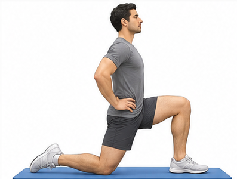 | 3 × 45 sec/side | Half-kneeling; posterior pelvic tilt; move forward gently. |
| Glute bridge with pause | 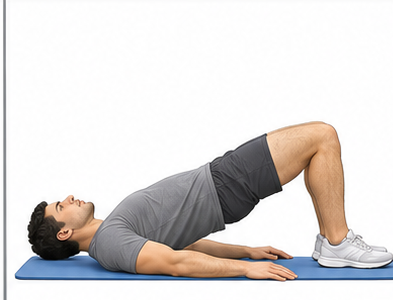 | 4 × 12; 3-sec hold | Push through heels; do not arch low back. |
| Hip thrust — bodyweight/light | 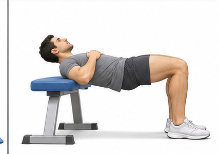 | 3 × 12 | Ribs down; squeeze glutes at top. |
| Clamshell — added | 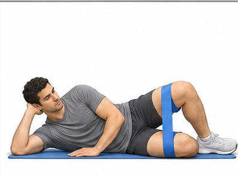 | 3 × 15/side | Keep pelvis stacked; do not roll back. |
| Lateral band walk — added | 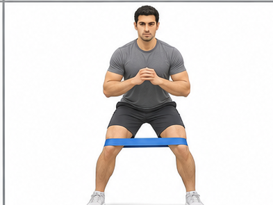 | 3 × 10 steps/side | Knees over toes; no knee valgus. |
| Dead bug | 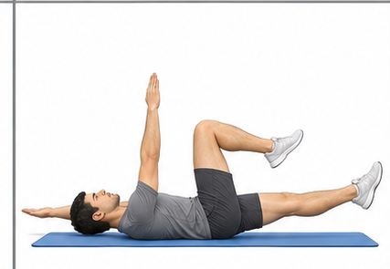 | 4 × 10/side | Press low back into floor. |
| Plank + side plank | 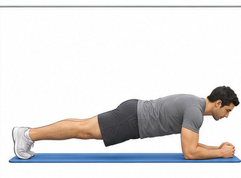 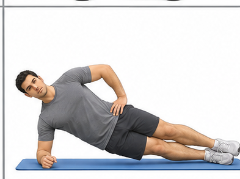 | 3 × 45–60 sec/position | Straight body line; no hip drop. |

**Cool-down:** quadriceps, hamstring, calf, and iliopsoas stretching — 5–8 min.

---

## Day 2 — Wednesday: Upper Body + Ankle Stability + Balance

| Exercise | Image | Dose | Key Cue |
| --- | --- | --- | --- |
| Seated & standing calf raises | 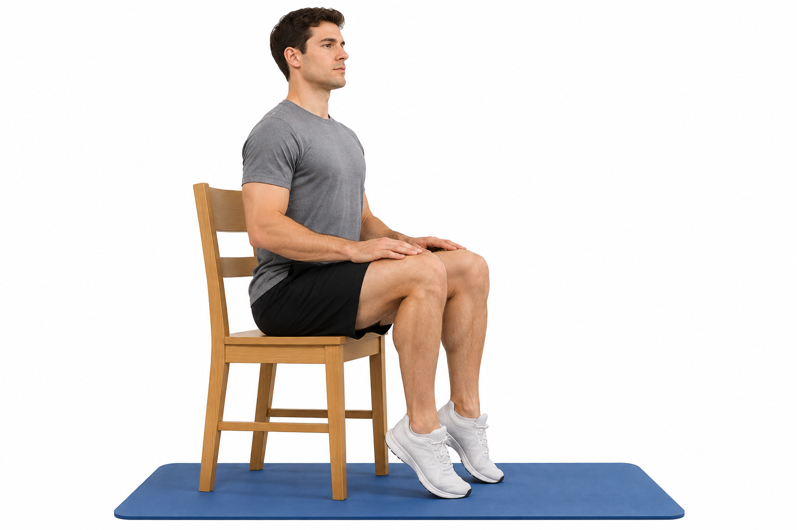 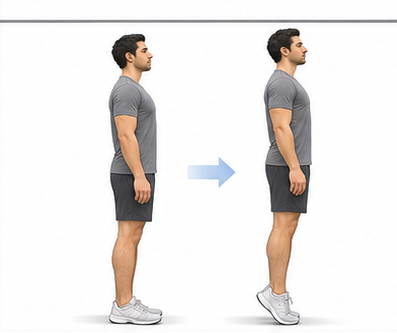 | 4 × 20 slow | Full control; pause at top. |
| Ankle eversion with band — added | 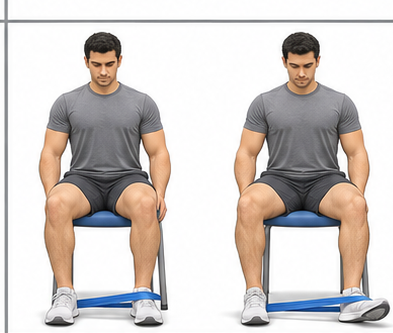 | 3 × 15/side | Slow return; keep leg still. |
| Single-leg balance perturbations | 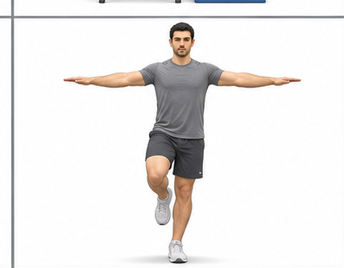 | 3 × 45 sec/side | Knee straight; prevent inward collapse. |
| Ankle balance on foam pad | 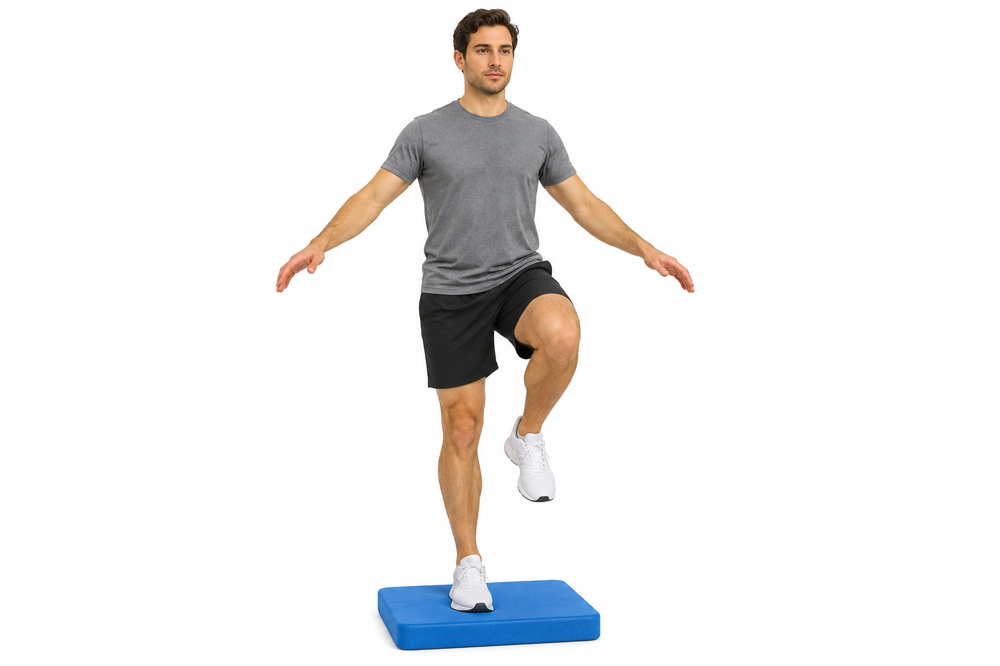 | 3 × 60 sec/side | Barefoot if safe; progress from firm to foam. |
| Upper-body push/pull | 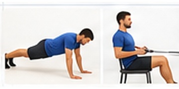 | 4–5 exercises × 3 × 10–12 | Avoid positions that compress the knee. |
| Bird-dog | 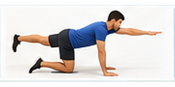 | 3 × 12/side | No pelvis rotation or back arch. |

**Cool-down:** calf, hamstring, chest, and lat stretching — 5–8 min.

---

## Day 3 — Friday: Quad-Safe Strength + Hamstring + Movement Integration

| Exercise | Image | Dose | Key Cue |
| --- | --- | --- | --- |
| Terminal knee extension with band | 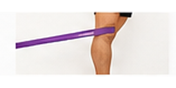 | 4 × 15/side | Squeeze quad; full knee extension. |
| Isometric wall sit — safe angle | 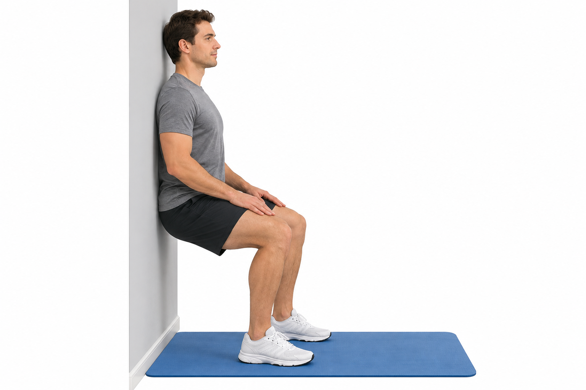 | 4 × 45–60 sec | Pain-free angle; no sharp pain. |
| Active hamstring stretch | 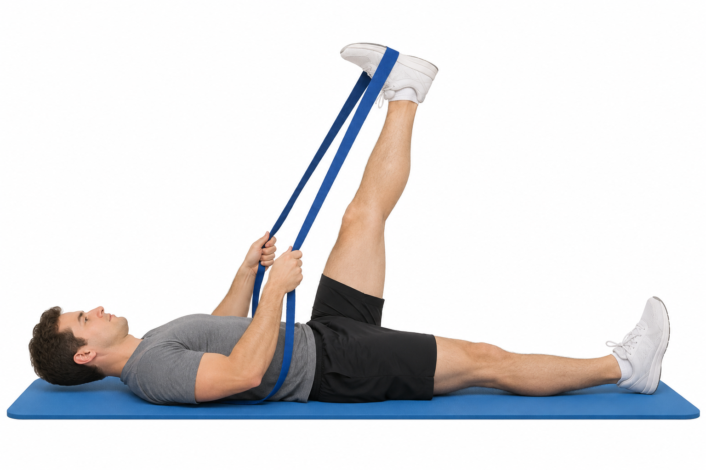 | 3 × 12/side | Neutral spine; controlled range. |
| Hamstring curl on ball — added | 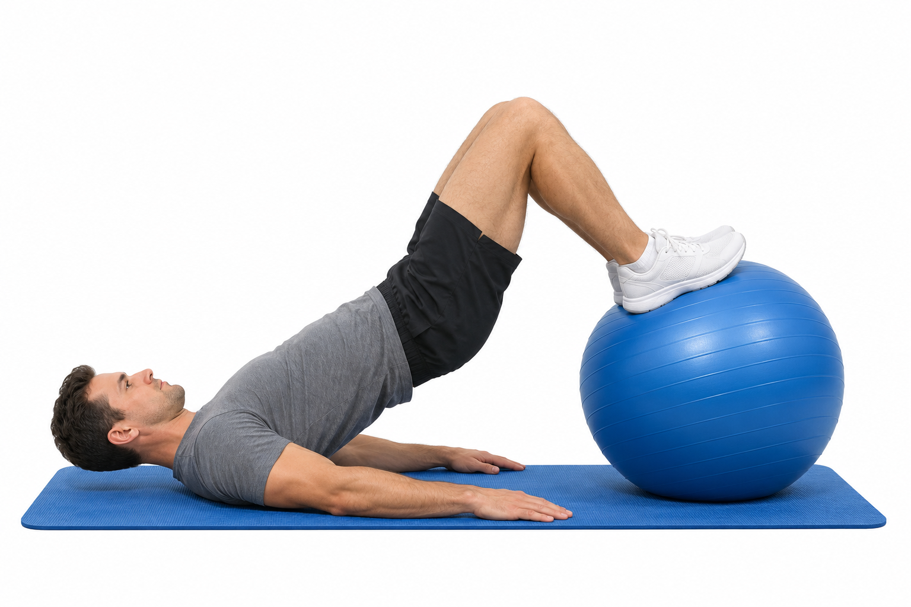 | 3 × 10–12 | Hips lifted; slow return. |
| Single-leg glute bridge | 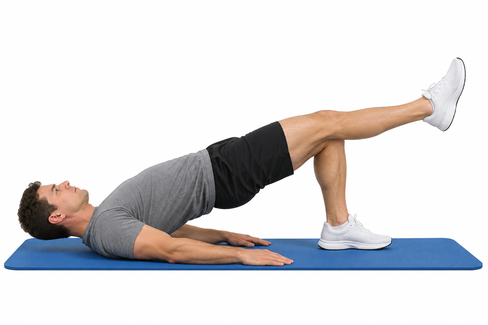 | 3 × 10/side | Keep pelvis level. |
| Box squat — controlled eccentric | 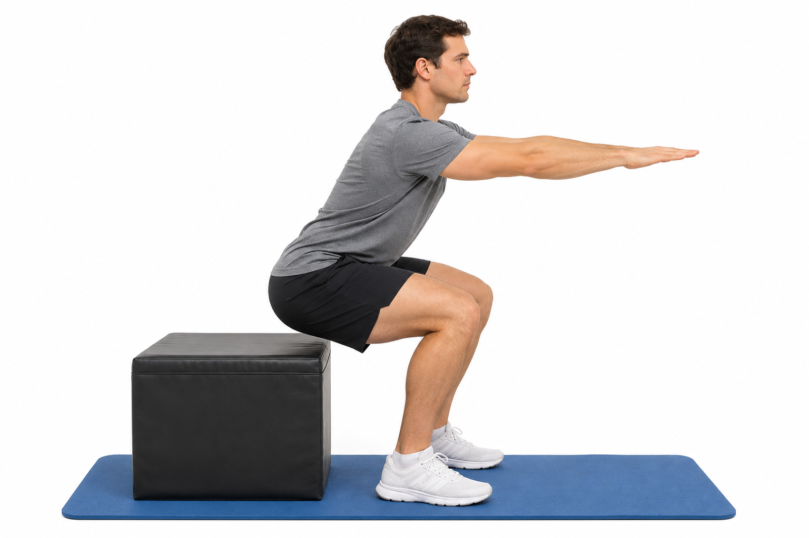 | 3 × 10; 3-sec down | Hips back; knees track over toes. |
| Retro-step downs — low box | 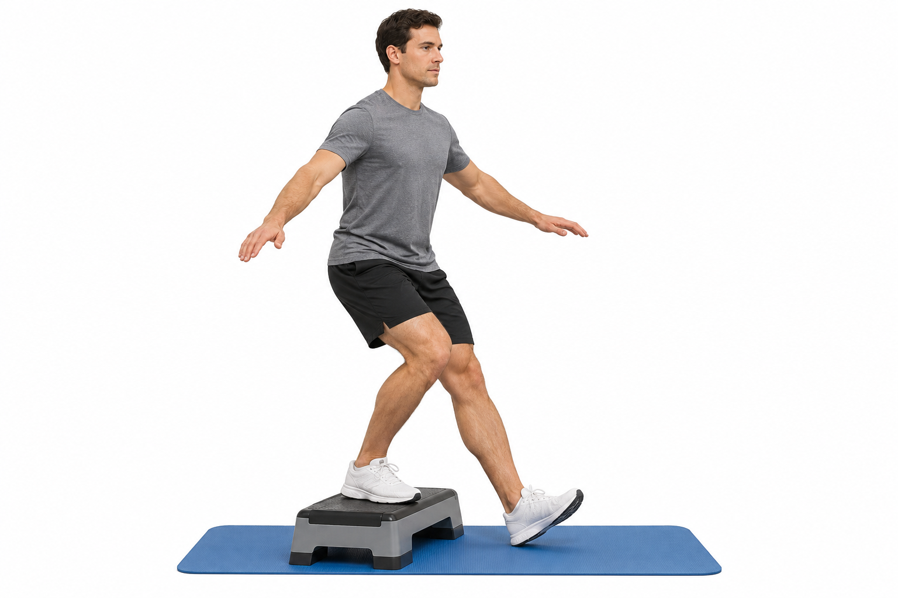 | 3 × 12/side | Slow; stable knee; no valgus. |

**Cool-down:** foam rolling quads, hamstrings, calves + static stretching — 15–20 min.

---

## Golden Rules and Progression

- **Pain rule:** mild muscle effort is OK; sharp knee pain, catching, or painful grinding = stop.
- **Load:** start light; RPE **4–6/10** for strengthening exercises.
- **Tempo:** 3 seconds down in squat/step/bridge movements.
- **Knee alignment:** avoid knee valgus during step-downs, squats, and stairs.
- **Progress only if:** pain ≤3/10 during exercise and no worse next day.
- **Monitor:** single-leg squat quality, balance time, stair pain, and 24-hour response.
- **If medial knee pain persists or increases:** review diagnosis and program with a clinician.