# البرنامج التأهيلي العلاجي الأسبوعي المكثف (5 أيام)

**خطة علاجية متقدمة لتأهيل مفصل الركبة، استعادة التوازن العضلي، وتقوية ثبات الكاحل والجذع**

**الصور:** رسوم توضيحية مولدة بالذكاء الاصطناعي؛ اتبع تعليمات المعالج عند التنفيذ. احتفظ بمجلدي `GM` و`CX` معًا لعرض الصور المحلية.

---

## بيانات الحالة والتقييم

| البيانات | التفاصيل |
| ---: | ---: |
| **اسم الحالة** | مصطفى يحيى منصور |
| **السن** | 33 سنة |
| **ملخص التقييم الطبي** | 1. لين غضروف الركبة (Chondromalacia) 2. ألم بالجزء الداخلي للركبة (Medial Knee Pain) 3. قصر بالعضلات الخلفية (Hamstring Shortened) 4. ضعف بالعضلات الأمامية (Quads Weak) 5. خمول بالعضلة الألوية الكبرى (Glutes Max Inhibition) 6. ضيق بعضلات ثني الفخذ (Iliopsoas Tight) 7. عدم استقرار الكاحل وتأهيل العضلة الظنبوبية الخلفية (Ankle Instability / Posterior Tibialis) 8. ثبات الجذع (Core Stability) 9. الاهتمام بالبدائل السليمة للأنماط الحركية |
| **هيكل الجلسة** | **معدل ساعتين لكل جلسة:** إحماء عصبي وعضلي (20 دقيقة) + التمارين الرئيسية والمقاومة (60 دقيقة) + تمارين الثبات والتحكم الحركي (25 دقيقة) + إطالات واستشفاء (15 دقيقة). |

---

## اليوم الأول (الإثنين): الجزء السفلي (المؤخرة، العضلة الحرقفية، وثبات الجذع)

*الهدف: إيقاظ العضلات الخاملة (Glutes Max)، علاج ضيق عضلات ثني الحوض، وتثبيت الجذع.*

| اسم التمرين | الصورة | طريقة الأداء الصحيحة | المجاميع والعدات |
| :--- | :---: | ---: | ---: |
| **إطالة العضلة الحرقفية** *(Iliopsoas Stretch)* | 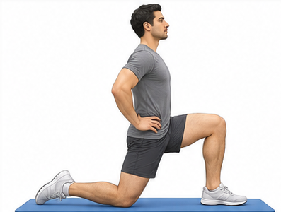 | اتخذ وضعية الركوع على ركبة واحدة مع وضع القدم الأخرى أمامك بزاوية 90 درجة. أرجع الحوض للوراء قليلاً واقبض عضلة المؤخرة للرجل الخلفية، ثم تحرك للأمام ببطء حتى تشعر بإطالة في مقدمة الحوض. | 3 مجموعات × 45 ثانية ثبات لكل جانب |
| **جسر المؤخرة مع ثبات** *(Glute Bridge with Pause)* | 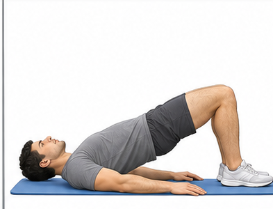 | استلقِ على ظهرك مع ثني الركبتين وتثبيت القدمين على الأرض. ادفع بكعبيك لرفع الحوض لأعلى مع قبض عضلات المؤخرة بقوة دون تقوس أسفل الظهر، واثبت في الأعلى. | 4 مجموعات × 12 تكرار *(ثبات 3 ثوانٍ في الأعلى)* |
| **دفع الحوض على البنش** *(Hip Thrust - Light / BW)* | 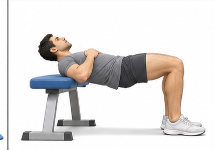 | اسند أعلى ظهرك على حافة بنش مستقر وثبّت قدميك على الأرض بعرض الكتفين. ادفع الحوض لأعلى حتى يصبح الجسم في خط مستقيم مع قبض المؤخرة بقوة في القمة. | 3 مجموعات × 12 تكرار *(مقاومة خفيفة أو وزن الجسم)* |
| **تمرين الديد باج** *(Dead Bugs)* | 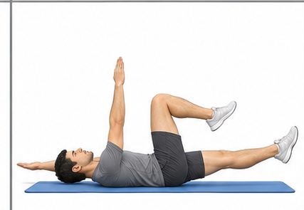 | استلقِ على ظهرك وارفع ذراعيك للأعلى واثنِ ركبتيك بزاوية 90 درجة. اضغط أسفل ظهرك للأرض، ثم أنزل ذراعاً ورجلاً معاكسة ببطء مع الحفاظ على ثبات الظهر. | 4 مجموعات × 10 تكرارات لكل جانب |
| **بلانك أمامي وجانبي** *(Plank & Side Plank)* | 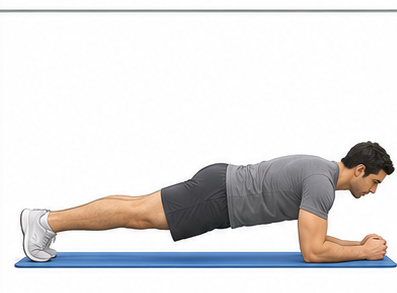 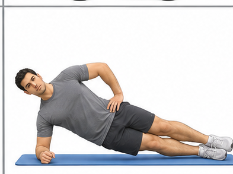 | ارتكز على الساعدين وأطراف الأصابع مع الحفاظ على استقامة الجسم بالكامل دون هبوط الحوض، ثم انتقل للوضع الجانبي لدعم عضلات الجذع الجانبية. | 3 جولات × ثبات 45–60 ثانية لكل وضع |

---

## اليوم الثاني (الثلاثاء): الجزء العلوي + استقرار الكاحل

*الهدف: الحفاظ على لياقة الجزء العلوي دون إجهاد الركبة، مع تقوية العضلة الظنبوبية الخلفية وثبات الكاحل.*

| اسم التمرين | الصورة | طريقة الأداء الصحيحة | المجاميع والعدات |
| :--- | :---: | ---: | ---: |
| **رفع الكعبين من الجلوس والوقوف** *(Seated & Standing Calf Raises)* | 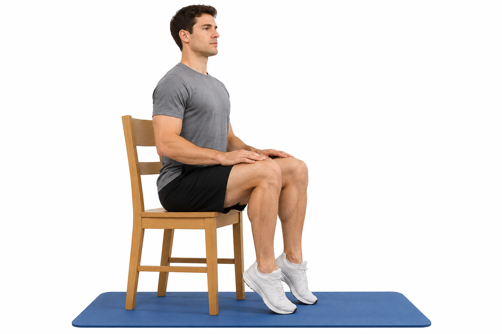 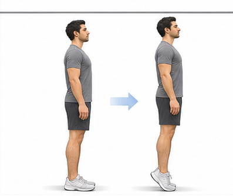 | ارفع كعبيك لأعلى ببطء وتحكم مع بقاء مقدمة القدم والأصابع ثابتة على الأرض لتقوية العضلة الظنبوبية الخلفية وعلاج عدم استقرار الكاحل. | 4 مجموعات × 20 تكرار *(تركيز على التحكم البطيء)* |
| **التوازن على قدم واحدة** *(Single-Leg Balance)* | 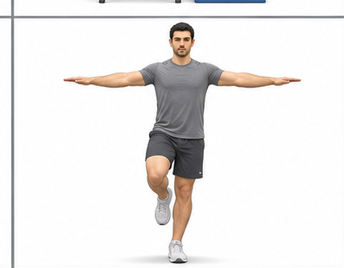 | قف على قدم واحدة فوق أرضية ثابتة أو وسادة توازن، وحافظ على استقامة الركبة ومنع ميلها للداخل مع ثبات مفصل الكاحل. | 3 جولات × 45 ثانية لكل ساق |
| **تمارين الجزء العلوي** *(Upper Body Push & Pull)* | 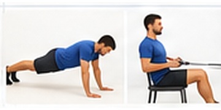 | أداء 4 إلى 5 تمارين للجزء العلوي حسب جدولك المعتاد (مثل السحب الأرضي، وضغط الصدر بالدمبلز) في وضعيات لا تسبب ضغطاً على مفصل الركبة. | 4–5 تمارين × 3 مجموعات × 10–12 تكرار |

---

## اليوم الثالث (الأربعاء): راحة / استشفاء نشط

> مشي خفيف على أرض مستوية أو جلسة إطالات خفيفة جداً بدون أي أحمال لإراحة المفاصل والعضلات.

---

## اليوم الرابع (الخميس): تقوية الفخذ الأمامية (آمنة للغضروف) + الخلفية

*الهدف: علاج ضعف العضلات الأمامية (Quads) وقصر الخلفية بأمان تام لحماية غضروف الركبة (Chondromalacia).*

| اسم التمرين | الصورة | طريقة الأداء الصحيحة | المجاميع والعدات |
| :--- | :---: | ---: | ---: |
| **مد الركبة النهائي بالشريط** *(Terminal Knee Extensions - TKEs)* | 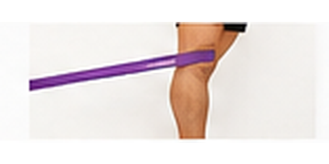 | اربط شريطاً مطاطياً بنقطة ثابتة وخلف ركبتك. قف بانحناء بسيط في الركبة، ثم ادفع كعبك للأرض وافرد ساقك بالكامل ضد مقاومة الشريط مع قبض العضلة الأمامية. | 4 مجموعات × 15 تكرار لكل ساق |
| **الوقوف الثابت على الحائط** *(Isometric Wall Sits)* | 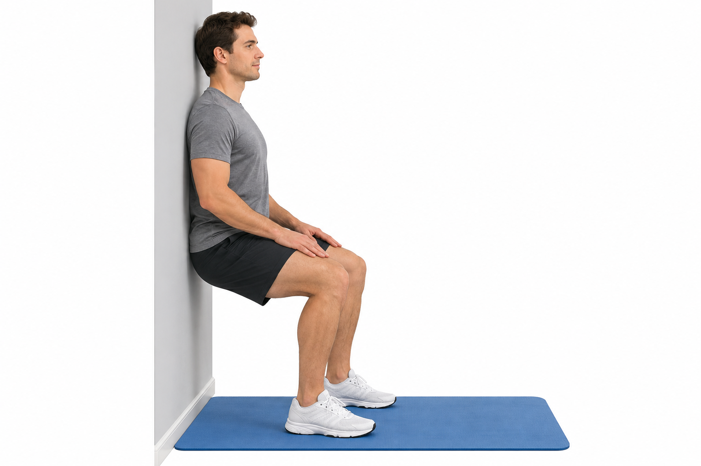 | اسند ظهرك إلى الحائط وانزل بزاوية مريحة للركبة خالية تماماً من الألم الحاد (فوق 60 درجة) لبناء قوة تحمل الأوتار والغضاريف بأمان. | 4 جولات × 45–60 ثانية ثبات |
| **إطالة العضلات الخلفية النشطة** *(Active Hamstring Stretches)* | 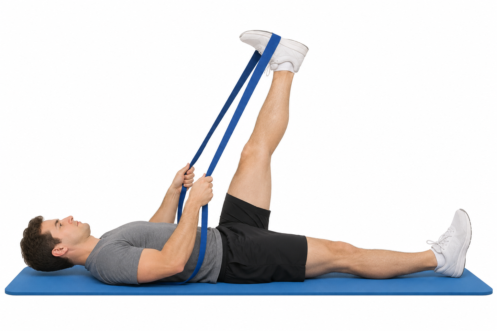 | أجرِ إطالة لطيفة ومتحكم فيها لعضلات خلف الفخذ لعلاج القصر العضلي مع الحفاظ على استقامة الظهر تماماً لتجنب الضغط على الفقرات. | 3 مجموعات × 12 تكرار لكل ساق |
| **سكوات الصندوق العكسي البطيء** *(Box Squat - Controlled Eccentric)* | 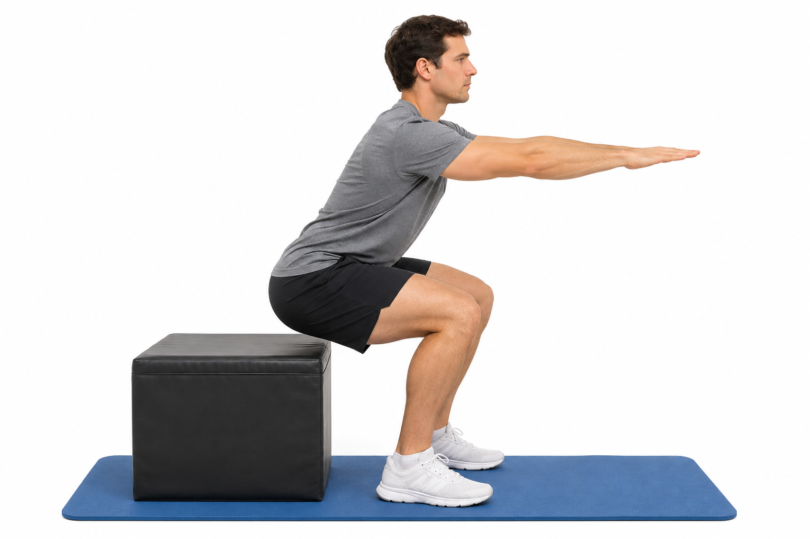 | انزل ببطء شديد (3 ثوانٍ للنزول) للجلوس على صندوق مرتفع نسبياً مع دفع الحوض للخلف والحفاظ على اتجاه الركبتين مع مشط القدم. | 3 مجموعات × 10 تكرارات *(نزول بطيء 3 ثوانٍ)* |

---

## اليوم الخامس (الجمعة): تكامل حركة الجسم والثبات الحركي

*الهدف: ربط الجذع بالحركة السفلية وتصحيح أي ميل أو ألم في الجزء الداخلي للركبة (Medial Knee Pain).*

| اسم التمرين | الصورة | طريقة الأداء الصحيحة | المجاميع والعدات |
| :--- | :---: | ---: | ---: |
| **الخطوات العكسية البطيئة** *(Retro-Step Downs)* | 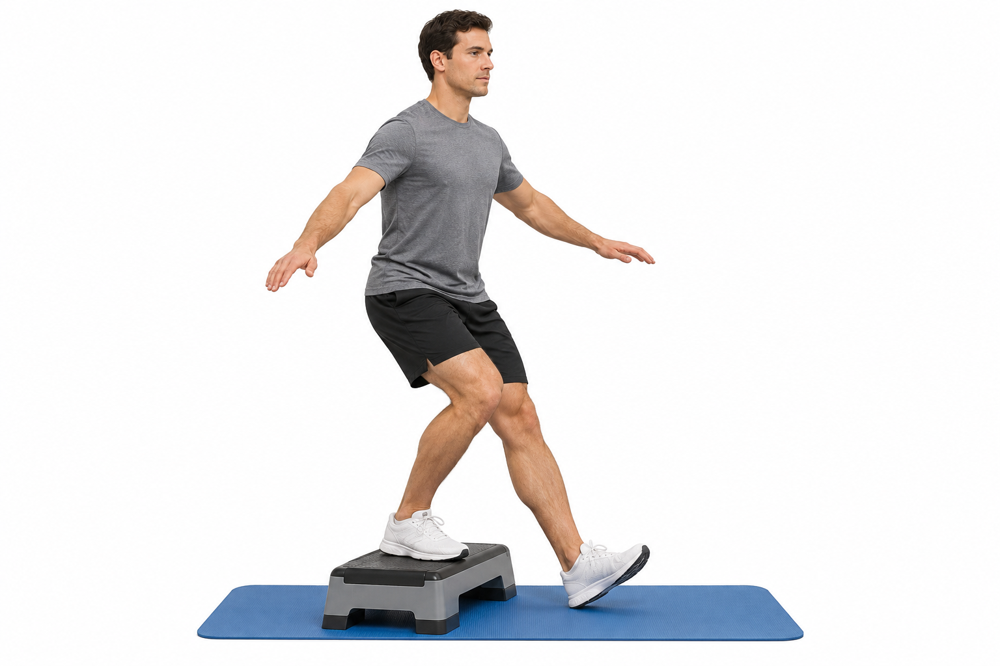 | قف فوق صندوق منخفض وانزل بكعب القدم الأخرى ببطء للأمام مع تركيز تام على ثبات الركبة الداعمة وعدم ميلها للداخل. | 3 مجموعات × 12 تكرار لكل ساق |
| **جسر المؤخرة برجل واحدة** *(Single-Leg Glute Bridge)* | 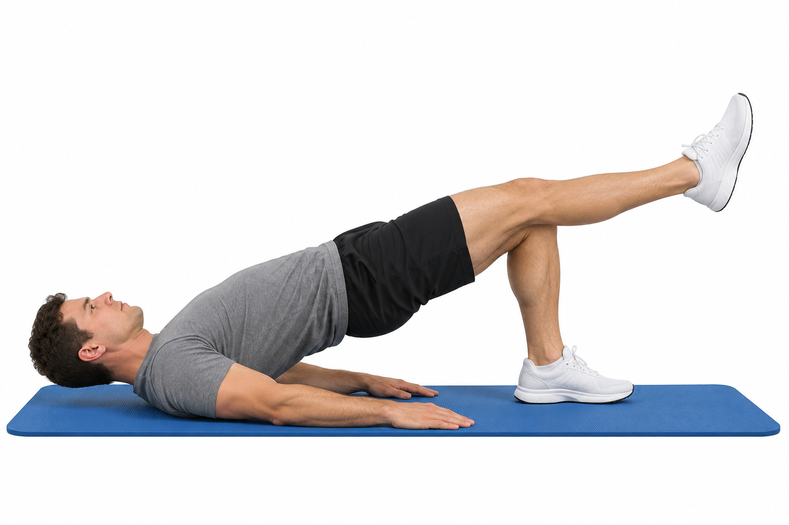 | استلقِ على ظهرك وارفع إحدى الساقين، ثم ادفع بكعب القدم المثبتة على الأرض لرفع الحوض مع الحفاظ على توازن الجانبين. | 3 مجموعات × 10 تكرارات لكل ساق |
| **تمرين الطائر/الكلب للجذع** *(Bird-Dog Core Exercise)* | 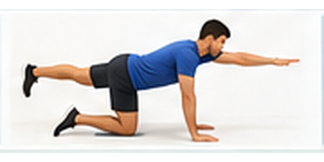 | ارتكز على اليدين والركبتين، ثم مد ذراعاً وساقاً معاكسة باستقامة تامة مع تثبيت الجذع ومنع دوران الحوض أو تقوس الظهر. | 4 مجموعات × 12 تكرار بالتبادل |
| **توازن الكاحل على وسادة التوازن** *(Foam Pad Balance)* | 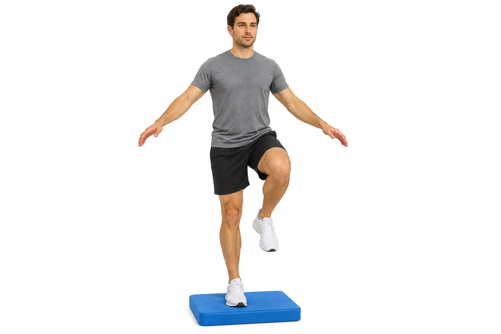 | قف على قدم واحدة فوق وسادة توازن غير مستقرة لتعزيز الاستجابة العصبية لعضلات الكاحل ومنع الالتواءات. | 3 جولات × 60 ثانية لكل ساق |

---

## اليوم السادس (السبت): استشفاء وإطالات عميقة

*الهدف: تحرير التوتر العضلي المتراكم واستعادة المرونة الكاملة للعضلات المحيطة بالحوض والركبة.*

| اسم التمرين | الصورة | طريقة الأداء الصحيحة | المجاميع والعدات |
| :--- | :---: | ---: | ---: |
| **التدليك الذاتي بالأسطوانة الإسفنجية** *(Foam Rolling & Stretches)* | 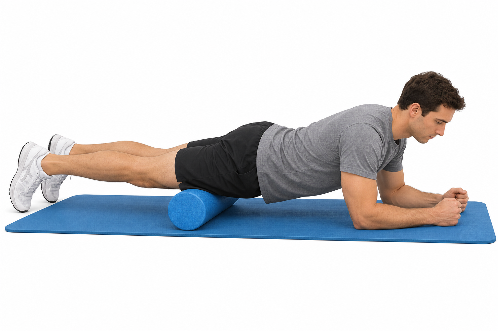 | مرر عضلات الفخذ الأمامية والخلفية والسمانة ببطء فوق الأسطوانة الإسفنجية لفك العقد العضلية، يليها إطالات ثابتة لكل من Iliopsoas وHamstrings وQuads. | 15–20 دقيقة استشفاء شامل |

---

## قواعد ذهبية للتنفيذ والمتابعة (بناءً على توجيهات المعالج)

1. **تجنب الألم الحاد:** الإجهاد العضلي البسيط مسموح، أما إذا شعرت بأي طقطقة مؤلمة أو احتكاك حاد في صابونة الركبة فأوقف التمرين فوراً.
2. **التحكم العضلي البطيء (Tempo):** في تمارين الفخذ الأمامية والخلفية، اجعل النزول في الحركة يستغرق 3 ثوانٍ كاملة لزيادة كفاءة التحميل دون أوزان ضخمة تضر الغضروف.
3. **الاهتمام بالبدائل الحركية السليمة:** الحرص الدائم على عدم ميل الركبة للداخل (Knee Valgus) أثناء النزول أو صعود الدرج، والحفاظ على استقامة الكاحل والحوض.